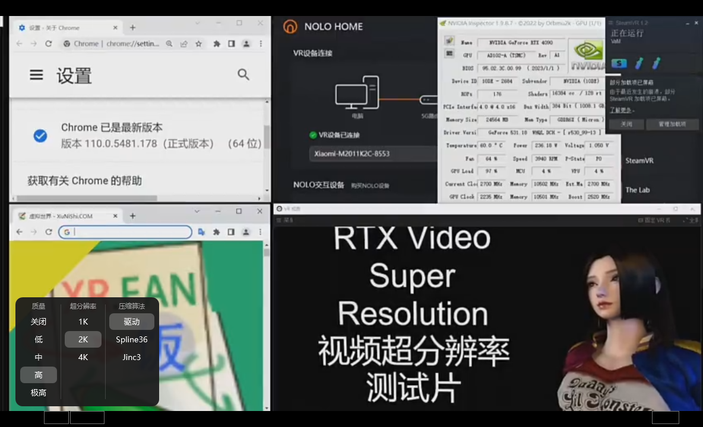
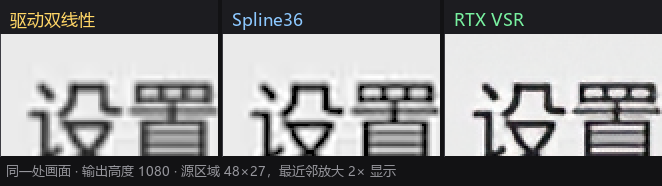

<!-- 中文说明（本 fork 主页优先展示） -->

> [!WARNING]
> **这是个人修改版（fork），不是 QuickLook 官方版本。**
> 官方版本与下载请前往 **[QL-Win/QuickLook](https://github.com/QL-Win/QuickLook)**。

# QuickLook · 看片版

在官方版基础上做了两件事：

1. **视频预览换成新的渲染内核**（D3D11 + Media Foundation），并接入 **NVIDIA RTX VSR 超分辨率**；
2. **键盘操作真正可用** —— 按空格打开视频后，方向键立刻生效，不用先点一下窗口。

## 视频超分（RTX VSR）

按控制栏的 `S/W · H/W` 按钮决定走哪条播放路径：

| 档位 | 播放路径 | VSR |
|---|---|---|
| **H/W**（默认） | 新引擎：D3D11 + DXVA 硬解 | 可用 |
| **S/W** | 原播放器：WPFMediaKit + LAV 软解，**不创建任何 D3D 对象** | 不可用 |

> 显卡跑不了 VSR（AMD / GTX 10 系 / 驱动过旧）时，H/W 会自动退回**原播放器 + LAV 硬解**，
> 播放本身不受影响，也不会弹错误框。

点 `VSR` 按钮打开的菜单：



- **质量**：关闭 / 低 / 中 / 高 / 极高
- **超分辨率**：输出高度的**上限** —— `1K`(1080) / `2K`(1440) / `4K`(2160)。
  实际倍率由引擎按源高度和窗口尺寸换算，永远不超过这个上限，也不会超过 NGX 规格的 4×。
- **压缩算法**：`驱动` / `Spline36` / `Jinc3` —— VSR 之后缩到窗口尺寸用的缩放器。

### 三挡位细节对比

同一帧、同一输出尺寸，左 → 右依次是 **驱动双线性 / Spline36 / VSR**。
三张图截的是源画面同一处 48×27 区域，按 2× 最近邻放大显示，没有做任何插值或降采样。
点开图片可看原始尺寸。

**1K · 1920×1080**



**2K · 2560×1440**


**4K · 3840×2160**


边缘能量（相邻像素亮度差的平均值，越高越锐）：

| 挡位 | 驱动双线性 | Spline36 | **VSR** | VSR / 双线性 |
|---|---|---|---|---|
| 1K · 1920×1080 | 3.089 | 3.871 | **4.296** | **+39%** |
| 2K · 2560×1440 | 2.360 | 2.941 | **3.323** | **+41%** |
| 4K · 3840×2160 | 1.592 | 1.978 | **2.159** | **+36%** |

测试片 848×478，取 30s 处同一帧；只改「超分辨率」挡位，其余设置不变。
VSR 不只是比双线性锐，也稳定高于 Spline36（+9% ~ +13%），说明它确实在重建细节而不是插值。

## 搭配：先把网页视频存到本地

预览器只认本地文件。想在电脑上补番、追剧、存直播回放，先用浏览器扩展把片子落地，
再用这里预览，效果最好 —— 低清的源正好交给上面的 VSR 拉起来。

**[FetchV](https://fetchv.net/)**（M3U8/HLS 视频下载器）比较省事：

- 嗅探页面里的 `m3u8` / MP4 / WebM，把 HLS 的分片自动合并成单个 **MP4**；
- 有多档分辨率时默认挑最高的，也可以手动选；
- 直播、或播放器是 `blob:` 地址抓不到真实链接时，用「录制模式」把缓冲数据转成 MP4；
- 全部在浏览器本地完成，不经过第三方服务器。

| 浏览器 | 安装 |
|---|---|
| Edge | [加载项商店](https://microsoftedge.microsoft.com/addons/detail/dbepbhhcmhodojepbagfppgpieeplpik) |
| Chrome | [Chrome 应用商店](https://chromewebstore.google.com/detail/nfmmmhanepmpifddlkkmihkalkoekpfd) |

用法：打开播放页 → 点扩展图标 → 选条目点下载 → 完成后保存 →
在资源管理器里选中、按空格预览。720p 及以下的源开 H/W 走 VSR，
比在网页里全屏看干净不少。

> FetchV 是第三方工具，与本项目没有关系。能不能下、下了能不能用，取决于平台条款和当地版权规定；
> 请只保存自己有权保存的内容。

## 快捷键

| 按键 | 行为 |
|---|---|
| `←` / `→` | 快退 / 快进 **5 秒** |
| `↑` / `↓` | 音量 **−5% / +5%** |
| `空格`（资源管理器内选中视频） | 打开预览，**键盘焦点直接落在视频上** |
| `ESC` | 关闭预览，焦点回到资源管理器，方向键恢复「选择文件」 |

按方向键时控制栏会短暂浮现，给出进度 / 音量反馈。

## 行为说明

- **仅视频生效**：音频（mp3 / flac）、图片、PDF、Office 等其他预览类型与官方版**完全一致**。
- **单击不再播放 / 暂停**（按需求移除）；按住拖动移动窗口保留，并顺带修掉了「窗口最大化时点击崩溃」的 `DragMove` 异常。
- 预览窗口已打开时，在资源管理器里用方向键切换文件、预览跟随更新的原有行为**不受影响**。
- 空格仍然是「关闭预览」，没有被占用为播放 / 暂停。
- **放大窗口会重新算倍率**：打开时窗口通常和视频差不多大（这时按设计不开超分），
  把预览拉大之后会按当前挡位重新计算，缩回 1:1 以下自动关掉。
- **不再爆显存 / 爆内存**：解码和超分跑在一个独立的引擎进程里，主程序只负责显示和遥控，
  翻片时线程数、内存、显存都是一条直线（旧版每预览一次会多留 55 个线程 + 250 MB 显存，关掉也不回落）。
  画面通过共享显存零拷贝传给主程序，像素不经过内存。
- **回收只关引擎，不动主程序**：所有预览关掉、闲置 30 秒后，只把引擎子进程关掉，
  QuickLook 本体全程不退出、托盘不闪、游戏里也不会把它当成「程序结束」。
  看片过程中永远不会触发。
- **排障开关 `IsolatedEngine`**：默认 `true`（引擎跑在独立进程里）。改成 `false` 就退回
  「引擎直接跑在 QuickLook 进程内」的老跑法——出画面/声音问题时用来二分定位，
  代价是显存和内存不再归还（那个设备在进程内本来就放不掉）。
  改法：关掉 QuickLook，编辑 `%APPDATA%\pooi.moe\QuickLook\QuickLook.Plugin.VideoViewer.config`，
  在 `</Settings>` 前加一行 `<IsolatedEngine>False</IsolatedEngine>`，再启动。
  当前走的是哪条，看日志里有没有 `proxy: 宿主进程已就绪` 就知道了。
- 运行中切换 `S/W · H/W` 会带着播放位置和播放状态切过去，不会回到片头。

## 环境要求

- Windows 10 / 11（x64 / Arm64 原生组件齐全）
- VSR 需要 **NVIDIA RTX 20 系及以上** + 较新的驱动；不满足时自动降级，不影响普通播放

## 改动范围

- `QuickLook.Plugin/QuickLook.Plugin.VideoViewer/Engine/` —— 新渲染内核
  （`VideoEngine` 解码/渲染/音频时钟、`Scaler` 着色器缩放、`AudioOutput`、`TimeStretcher`）
- `ViewerPanel.xaml(.cs)` —— 路径选择（S/W·H/W）、VSR 菜单、切换时保持位置
- `Styles.xaml` —— 按钮禁用态
- `QuickLook.Common/Plugin/ContextObject.cs`、`QuickLook/ViewerWindow.Actions.cs`、`Plugin.cs`
  —— 键盘聚焦（`FocusOnOpen`）

## 版本

- 基线：官方 `master` @ `2ec219a`
- 本 fork 的提交与安装包见 **[Releases](https://github.com/Binbin-miao/QuickLook/releases)** 与提交历史

---

<sub>以下为 **QuickLook 官方英文 README**，为便于与上游同步而原样保留 → [QL-Win/QuickLook](https://github.com/QL-Win/QuickLook)</sub>

---

<!-- Hero Section with Gradient Background Effect -->
<picture>
  <source media="(prefers-color-scheme: dark)" srcset="https://user-images.githubusercontent.com/1687847/82130498-8c3eac80-97d4-11ea-9e88-372ab9c50295.png">
  
</picture>

# QuickLook

<div align="center">

<h3>
  
  <i>Instant File Previews, Just Press Space</i>
  
</h3>

**The most powerful Quick Look implementation for Windows**

<a href="https://trendshift.io/repositories/3258">
  
</a>
<a href="https://hellogithub.com/repository/QL-Win/QuickLook" target="_blank">
  
</a>

<br>

<!-- Animated Badges -->
<p>
  <a href="https://quicklookapp.vercel.app">
    
  </a>
  <a href="https://github.com/QL-Win/QuickLook/releases">
    
  </a>
  <a href="https://github.com/QL-Win/QuickLook/releases">
    
  </a>
  <a href="https://github.com/QL-Win/QuickLook/stargazers">
    
  </a>
  <a href="https://www.gnu.org/licenses/gpl-3.0.en.html">
    
  </a>
<a href="https://github.com/QL-Win/QuickLook/actions/workflows/msbuild.yml">
  
</a>
<a href="https://dotnet.microsoft.com/en-us/download/dotnet/latest/runtime">
  
</a>
</p>


<br><br>

<!-- Hero Image with Modern Styling -->


<br><br>

<!-- Quick Navigation with Icons -->
<table>
  <tr>
    <td align="center" width="20%">
      <a href="#-the-problem">
        <br>
        <b>The Problem</b>
      </a>
    </td>
    <td align="center" width="20%">
      <a href="#-superpowers">
        <br>
        <b>Superpowers</b>
      </a>
    </td>
    <td align="center" width="20%">
      <a href="#-get-started">
        <br>
        <b>Get Started</b>
      </a>
    </td>
    <td align="center" width="20%">
      <a href="#-extend">
        <br>
        <b>Extend</b>
      </a>
    </td>
    <td align="center" width="20%">
      <a href="#-community">
        <br>
        <b>Community</b>
      </a>
    </td>
  </tr>
</table>

</div>

<br>

---

## 💡 The Problem

<table>
<tr>
<td width="60%">

### Ever wished Windows had macOS's Quick Look?

You know the drill: you want to peek at a file, so you double-click, wait for an app to launch, view the file, close the app... **exhausting**, right?

macOS users? They just press <kbd>Space</kbd>. Instant preview. **Any file**. 

**Now Windows has it too.** 🎉

QuickLook brings that buttery-smooth, instant-preview experience to Windows. No more waiting. No more opening heavy applications just to peek at a document.

</td>
<td width="40%">

```
WITHOUT QuickLook:
┌─────────────────┐
│ 1. Double click │
│ 2. Wait...      │
│ 3. App loads    │
│ 4. View file    │
│ 5. Close app    │
└─────────────────┘
   ⏱️ ~10 seconds

WITH QuickLook:
┌─────────────────┐
│ 1. Press SPACE  │
│ 2. Done! ✨     │
└─────────────────┘
   ⚡ ~0.2 seconds
```

</td>
</tr>
</table>

<br>

---

## 🚀 Superpowers

<div align="center">

### What Makes QuickLook Extraordinary

</div>

<table align="center"  >
<tr>
<td align="center" width="33%">

### ⚡️ **Lightning Speed**


**Instant previews** with zero lag

Native performance that feels like magic

Hardware-accelerated rendering

</td>
<td align="center" width="33%">

### 🎨 **Gorgeous Design**


**Fluent Design System** integration

Beautiful on 4K displays

Touch-optimized interface

</td>
<td align="center" width="33%">

### 🌈 **100+ Formats**


Images, videos, documents, code

**3D models**, archives, fonts

Extensible with plugins

</td>
</tr>
</table>

<br>

<!-- Feature Grid with Modern Cards -->
<table align="center"  >
<tr>
<td width="50%">

#### 📸 **Visual Files**
- 🖼️ Images (JPEG, PNG, GIF, WebP, RAW)
- 🎬 Videos (MP4, AVI, MKV, MOV)
- 🎨 Photoshop (PSD), Illustrator (AI)
- 📐 3D Models (OBJ, STL, FBX)
- 🎭 Animated GIFs & APNGs

#### 📄 **Documents**
- 📝 PDF, Word, Excel, PowerPoint
- 📋 Text files with syntax highlighting
- 📊 Markdown with live rendering
- 📜 E-books (EPUB, MOBI)
- 📑 Comics (CBZ, CBR)

</td>
<td width="50%">

#### 💻 **Developer Files**
- 🐍 Python, JavaScript, C++, Rust
- 🌐 HTML, CSS, JSON, XML
- ⚙️ Config files (YAML, TOML, INI)
- 📦 Archives (ZIP, RAR, 7Z, TAR)
- 🔧 Binary files with hex view

#### 🎵 **Media**
- 🎵 Audio (MP3, FLAC, WAV, AAC)
- 🎼 Sheet music
- 🎨 Fonts (TTF, OTF, WOFF)
- 🖌️ Vector graphics (SVG, EPS)
- 📹 Subtitles (SRT, ASS)

</td>
</tr>
</table>

<br>

<div align="center">

### 🎯 **Works Everywhere**

<table>
<tr>
<td align="center" width="25%">

**File Explorer**


Native integration

</td>
<td align="center" width="25%">

**Open/Save Dialogs**


System-wide support

</td>
<td align="center" width="25%">

**3rd Party Managers**


Total Commander, xplorer²

</td>
<td align="center" width="25%">

**Cloud Storage**


OneDrive, Dropbox ready

</td>
</tr>
</table>

</div>

<br>

---

## 📦 Get Started

<div align="center">

### Choose Your Adventure

<br>

<table>
<tr>
<td align="center" width="25%">


### **Microsoft Store**

**Recommended for most users**

✅ Automatic updates
✅ Sandboxed security
✅ One-click install

<br>

<a href="https://www.microsoft.com/store/apps/9nv4bs3l1h4s">
  
</a>

<sub>⚠️ Limited Open/Save dialog support</sub>

</td>
<td align="center" width="25%">


### **Installer**

**Full-featured experience**

✅ Complete functionality
✅ Open/Save dialog support
✅ Portable option available

<br>

<a href="https://github.com/QL-Win/QuickLook/releases">
  
</a>

<sub>💎 Get the full power</sub>

</td>
<td align="center" width="25%">


### **Scoop**

**For command-line lovers**

✅ Easy updates
✅ Reproducible installs
✅ Version management

<br>

```powershell
scoop bucket add extras
scoop install quicklook
```

<sub>🤓 Power user choice</sub>

</td>
<td align="center" width="25%">


### **Nightly**

**Live on the edge**

✅ Latest features
✅ Bug fixes first
⚠️ May be unstable

<br>

<a href="https://github.com/QL-Win/QuickLook/releases/">
  
</a>

<sub>🌙 Experimental builds</sub>

</td>
</tr>
</table>

<br>

<details>
<summary><b>🤔 Not sure which version to choose?</b></summary>

<br>

| Feature | Store | Installer | Scoop | Nightly |
|---------|-------|-----------|-------|---------|
| Auto-updates | ✅ | ⚠️ | ✅ | ⚠️ |
| Open/Save dialogs | ❌ | ✅ | ✅ | ✅ |
| Portable mode | ❌ | ✅ | ❌ | ✅ |
| Stability | ✅✅✅ | ✅✅✅ | ✅✅✅ | ✅✅ |

📖 [Read the full comparison](https://github.com/QL-Win/QuickLook/wiki/Differences-Between-Distributions)

</details>

</div>

<br>

### ⚡ Quick Start in 10 Seconds

<table>
<tr>
<td width="50%">

```
Step 1️⃣  Install QuickLook
         ↓
Step 2️⃣  It runs automatically
         ↓
Step 3️⃣  Select any file
         ↓
Step 4️⃣  Press SPACE
         ↓
Step 5️⃣  🎉 Magic happens!
```

</td>
<td width="50%">

**💡 Pro Tips:**
- QuickLook lives in your system tray
- Works with **any file** in File Explorer
- Use arrow keys to preview multiple files
- Press `Esc` or `Space` again to close
- Drag files directly from the preview!

</td>
</tr>
</table>

<br>

---

## ⌨️ Master the Shortcuts

<div align="center">

### Your New Superpowers

<br>

<table>
<tr>
<td align="center" width="33%">

### 🎮 **Basic Controls**

| Key | Action |
|-----|--------|
| <kbd>Space</kbd> | Toggle preview |
| <kbd>Esc</kbd> <kbd>Space</kbd> | Close window |
| <kbd>Enter</kbd> | Open file |
| <kbd>↑</kbd> <kbd>↓</kbd> | Next/Previous |

</td>
<td align="center" width="33%">

### 🔍 **Navigation**

| Key | Action |
|-----|--------|
| <kbd>←</kbd> <kbd>→</kbd> | Navigate files |
| <kbd>Mouse Click</kbd> | Select file |
| <kbd>Page Up</kbd> <kbd>Down</kbd> | Scroll content |
| <kbd>Home</kbd> <kbd>End</kbd> | Jump to start/end |

</td>
<td align="center" width="33%">

### 🎨 **Advanced**

| Key | Action |
|-----|--------|
| <kbd>Wheel</kbd> | Zoom (images) |
| <kbd>Ctrl</kbd>+<kbd>Wheel</kbd> | Zoom (PDFs) |
| <kbd>L-Click Drag</kbd> | Rotate 3D |
| <kbd>M-Click Drag</kbd> | Pan 3D |

</td>
</tr>
</table>

<br>

> **💡 Pro Tip:** You can navigate files using arrow keys even when the preview window isn't focused!

</div>

<br>

---

## 🧩 Extend

<div align="center">

### Supercharge QuickLook with Plugins

*Transform QuickLook into a universal file viewer*

<br>

<!-- Featured Plugins Grid -->
<table align="center">
<tr>
<td align="center" width="50%">


### **OfficeViewer**

Preview **Word, Excel & PowerPoint** files

**No Microsoft Office required!**

<br>

```
✅ Native Office formats
✅ Standalone viewer
✅ Fast rendering
```

<a href="https://github.com/QL-Win/QuickLook.Plugin.OfficeViewer/releases">
  
</a>

</td>
<td align="center" width="50%">


### **PdfViewer-Native**

Enhanced PDF viewing with **WebView2**

Modern, fast, feature-rich

<br>

```
✅ Smooth scrolling
✅ Search & annotations
✅ Hardware acceleration
```

<a href="https://github.com/QL-Win/QuickLook.Plugin.PdfViewer-Native/releases">
  
</a>

</td>
</tr>
<tr>
<td align="center" width="50%">


### **PostScriptViewer**

Preview `.ps` and `.eps` files

Perfect for designers

<br>

```
✅ Vector rendering
✅ High quality output
✅ Professional formats
```

<a href="https://github.com/QL-Win/QuickLook.Plugin.PostScriptViewer/releases">
  
</a>

</td>
<td align="center" width="50%">


### **CADImport**

View CAD files natively

`.dwg`, `.dxf`, `.plt`, `.cgm`

<br>

```
✅ Engineering drawings
✅ Architecture files
✅ Technical diagrams
```

<a href="https://github.com/emako/QuickLook.Plugin.CADImport/releases">
  
</a>

</td>
</tr>
</table>

<br>

### 📦 How to Install or Upgrade Plugins

<table>
<tr>
<td width="33%" align="center">

**1️⃣ Download**

Get the `.qlplugin` file

</td>
<td width="33%" align="center">

**2️⃣ Install**

Ensure QuickLook is currently running, select the file and press `Spacebar`.

</td>
<td width="33%" align="center">

**3️⃣ Restart**

Click on the `Install` button, then restart QuickLook.

</td>
</tr>
</table>

### 📦 How to Remove Plugins

<table>
<tr>
<td width="33%" align="center">

**1️⃣ Quit**

Quit QuickLook.

</td>
<td width="33%" align="center">

**2️⃣ Navigate**

Navigate to the [Data location](https://github.com/QL-Win/QuickLook/wiki/Differences-Between-Distributions#user-data-location).

</td>
<td width="33%" align="center">

**3️⃣ Remove**

You should find several folders. Remove the one you do not want to use.

</td>
</tr>
</table>

<br>

<a href="https://github.com/QL-Win/QuickLook/wiki/Available-Plugins">
  
</a>
<a href="https://github.com/QL-Win/QuickLook/wiki/Available-Plugins#how-to-install-or-upgrade-a-plugin">
  
</a>

</div>

<br>

---

## 💖 Community

<div align="center">

### Join Thousands of Happy Users

<br>

<table>
<tr>
<td align="center" width="33%">


### **QQ Group**

Join our Chinese community

**371388501**

<br>

<a href="https://qm.qq.com/q/KIczirznua">
  
</a>

</td>
<td align="center" width="33%">


### **Translate**

Help QuickLook speak your language

Make it accessible

<br>

<a href="https://github.com/QL-Win/QuickLook/wiki/Translations">
  
</a>

</td>
<td align="center" width="33%">


### **Star Us**

Show your support

It means a lot!

<br>

<a href="https://github.com/QL-Win/QuickLook/stargazers">
  
</a>

</td>
</tr>
</table>

<br>

### 👨‍💻 For Developers

Interested in contributing? Check out our development resources:

<a href="https://github.com/QL-Win/QuickLook/wiki">
  
</a>
<a href="CodeMaid.config">
  
</a>
<a href="https://github.com/QL-Win/QuickLook/issues">
  
</a>

</div>

<br>

---

## 🙏 Credits

<div align="center">

### Built with Love by Amazing People

<br>

<table>
<tr>
<td align="center" width="25%">


**Design Team**

[@OiCkilL](https://twitter.com/OiCkilL)
[@QubitsDev](https://twitter.com/qubitsdev)
[@Donno](https://github.com/Donnnno)
[@Shomnipotence](https://github.com/Shomnipotence)

*Fluent UI & Icons*

</td>
<td align="center" width="25%">


**Contributors**

[Our Amazing Team](https://github.com/QL-Win/QuickLook/graphs/contributors)

*Code, translations & ideas*

</td>
<td align="center" width="25%">


**Open Source**

[Libraries We Use](https://github.com/QL-Win/QuickLook/wiki/On-the-Shoulders-of-Giants)

*Standing on giants*

</td>
<td align="center" width="25%">


**You!**

Every User Matters

*Thank you for using QuickLook*

</td>
</tr>
</table>

</div>

<br>

---

## 📜 License

<div align="center">

<br>


<br><br>

**QuickLook is free and open source under [GPL-3.0](https://opensource.org/licenses/GPL-3.0)**

*Free software, free forever. No ads, no tracking, no premium tiers.*

<br>

**Need commercial licensing?** Contact us for sublicensing options.

</div>

<br>

---

<div align="center">

<br>

## ⭐ Like QuickLook? Star the repo!

**Your support keeps this project alive and improving**

<br>

<a href="https://quicklookapp.vercel.app">
  
</a>
<a href="https://github.com/QL-Win/QuickLook/wiki">
  
</a>
<a href="https://github.com/QL-Win/QuickLook/issues">
  
</a>
<a href="https://github.com/QL-Win/QuickLook/releases">
  
</a>

<a href="https://github.com/adnan-bhaldar/QuickLook-Website">
  
</a>

<br><br>

<sub>Note: The official website content may be inaccurate or out of date. To help maintain the site, please submit a PR to <a href="https://github.com/adnan-bhaldar/QuickLook-Website">QuickLook Website Repository</a></sub>

<br>

<sub>Made with ❤️ by the QuickLook community</sub>

<br>

<!-- Animated Emojis Footer -->


</div>
